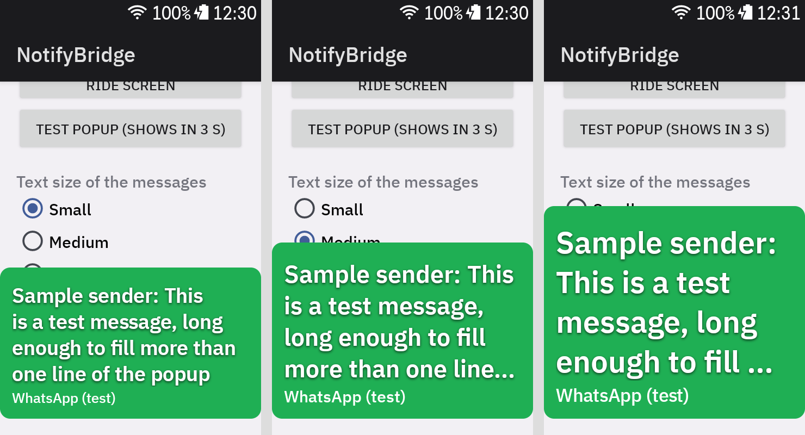
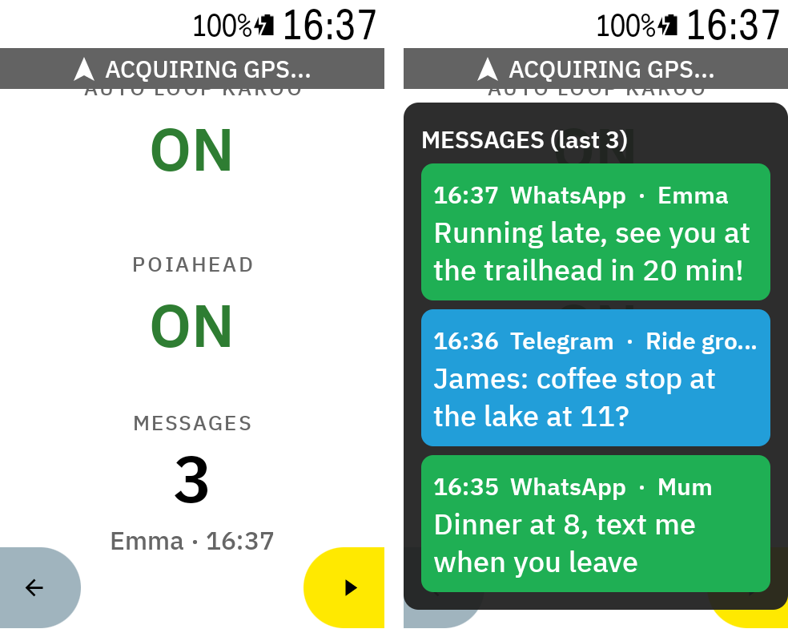

<picture>
  <source media="(prefers-color-scheme: dark)" srcset="https://gist.githubusercontent.com/anpaiss/78cf5eb76ad50594402b9778008a00a8/raw/NotifyBridge-card-dark.svg">
  
</picture>

# NotifyBridge

Your phone's messages and calls on the Hammerhead Karoo, in large type at the bottom of the ride screen, and only the ones you choose: app by app, and on WhatsApp and Slack person by person, group by group and channel by channel.

Two small apps, one on the phone and one on the Karoo, talking over Bluetooth. No account, no internet, no server in between. Paired once with a code, so every message travels encrypted and only your Karoo can read it.

## What you get

**On the ride screen.** Each message arrives as a popup at the bottom of the screen, where it does not cover the numbers at the top: the sender and the text in large bold type, up to four lines, the app's name below. It takes the app's colour (green WhatsApp, blue Telegram, orange for the others), plays two short beeps, and goes away after 10 seconds or with a tap. A call has a ring of its own, three rounds of two alternating tones, unlike any Karoo sound.

**Your choice of text size.** Small, Medium or Large, in the Karoo app. **Test popup** shows a sample message in the size you chose, without waiting for a real one.

**One popup at a time.** If a popup of my other extensions is on screen, the message waits for it, 30 seconds at most.

**Only what you choose**, on the phone:

- apps: each app appears in the list the first time it posts a notification, switched off. WhatsApp, SMS and calls are on from the start;
- WhatsApp: each person and each group appears under it after their first message, switched off. Switch on your family, leave the busy groups off;
- Slack: the same, with each direct message and each channel; a channel's threads go with the channel. Slack decides what makes a notification (its own settings: all messages, mentions only, keywords), NotifyBridge then picks among them;
- calls: a switch of their own, whatever app rings.

**Encrypted, paired once.** Bluetooth reaches anyone nearby. The first time, phone and Karoo pair with a six-digit code you compare on the two screens; from then on every message is encrypted with a key only the two of them hold, and a Karoo that is not paired receives nothing it can read.

**Read them again.** Every message also goes to the Karoo's notification centre, during a ride too: a popup you closed, or one that waited too long behind another, is still there. Not riding, that is the only place it goes, as the Karoo's own notifications do.

**A Messages field**, to put on any ride page: how many messages came in this ride and who sent the last one, at what time. Tap it and the last 10 open over the ride screen, newest first, each in its app's colour; a tap closes them, or 30 seconds. They are kept in memory only and cleared when the ride ends.

**inReach check** (optional). If you carry a Garmin inReach paired with the phone, the Karoo can warn you 1–2 minutes after the start when the inReach is neither connected to the phone nor seen nearby: off, or with its Bluetooth off. The warning is a full red screen with a siren every 10 seconds, until you tap it (the siren stops by itself after 10 minutes).

## Why it exists

The Karoo already shows the phone's notifications through the Hammerhead companion app, but all of them, with no filter. My work groups kept buzzing on my rides, to be closed one by one in the woods. NotifyBridge lets through only the people I want to hear from while I ride.

## Install

You need both apps: the phone app sends, the Karoo extension shows.

**On the Karoo**

1. Download `NotifyBridge.apk` from the latest release and sideload it, for example from the Hammerhead companion app, or with `adb install -r NotifyBridge.apk`.
2. Open **NotifyBridge** from the Karoo's extensions and tap **Allow popups over the ride screen**. Without it, messages use the Karoo's own alert at the top of the screen.
3. Choose the text size and tap **Test popup** to see it.

Once installed it appears in the Karoo **Extensions** library, and the Karoo checks there for a newer release.

**On the phone** (Android 12 or newer)

1. Download `NotifyBridge-phone.apk` from the same release and open it to install it.

   Google Play Protect may warn about it, or block the install. This is normal for an app installed from a file that asks for notification access: NotifyBridge needs it to read the messages it sends to the Karoo, and harmful apps ask for the same permission, so Play Protect is wary of all of them. The warning is about that permission, not about anything found in the app: no antivirus engine on VirusTotal flags it, and the code is open here (see [Is it safe?](#is-it-safe)).
2. Open **NotifyBridge**, tap **Start bridge** and allow **Nearby devices** (Bluetooth) and notifications.
3. Tap **Notification access** and switch NotifyBridge on.

   On Android 13 and newer the switch is greyed out at first, with "Restricted setting": Android does this for every app installed from a file rather than from the Play Store. Tap **App info**, then the **⋮** menu at the top right, then **Allow restricted settings**, and go back to **Notification access**. The app's first line says when access is granted.

**Pair them, once**

1. On the phone tap **Pair a Karoo**. You then have 2 minutes.
2. On the Karoo open **NotifyBridge** and tap **Pair with phone**.
3. Both screens show a six-digit code. If it is the same, tap **Same code: pair** on both. The phone then says "Paired Karoo: 1", the Karoo "Messages encrypted".
4. Tap **Send test** on the phone: during a ride it appears as the popup, otherwise in the Karoo's notification centre.

Until they are paired, no message reaches the Karoo. Pairing again (a new phone, a reinstalled app) asks first and replaces the key only when the new pairing succeeds. **Forget paired Karoos** on the phone deletes the keys, after a red warning.

To avoid every message twice, switch off the phone notifications of the Hammerhead companion app.

## How it works

The phone app reads the notifications Android shows, through the notification access you grant, and keeps only those of the apps, people and groups you switched on. It sends each one as a short Bluetooth Low Energy message to the Karoo: the app's name, the title (the sender, or the group) and the text, shortened to fit one message. Besides the messages it only tells the Karoo, when asked, whether it is still subscribed and whether a Garmin inReach paired with the phone is connected. It never replies to or acts on a notification.

Everything after pairing is encrypted: the messages, and the answer about the link and the inReach. In clear there is only whether the Karoo is subscribed and paired.

The Karoo extension looks for the phone by the Bluetooth service it advertises, connects, and checks the link every minute; when the phone goes out of range it looks again, at full speed for 2 minutes and then in low-power mode, and reconnects by itself. Every message becomes a Karoo notification, and during a ride also our popup.

## Pairing and encryption, in detail

- Pairing is an ECDH key exchange on P-256. The Karoo first sends only a hash of its public key and reveals the key after it has the phone's, so someone in between cannot try key after key until the codes match: one chance in a million. The six-digit code comes from the two public keys; comparing it is what proves no one is in between, so do compare it.
- The shared key is derived from the ECDH secret and the two public keys. Each message is sealed with AES-256-GCM and a random nonce: a message altered on the way, or sealed with another key, is refused.
- Each message carries its time, and the Karoo drops one older than 5 minutes: a message recorded on the air cannot be shown again later.
- The keys stay in each app's private storage. A device nearby can still connect to the phone and see that something is sent, and when, but not what.

## Privacy

No internet permission in either app, no account, no analytics. Your notifications go from the phone to the Karoo over Bluetooth and nowhere else, encrypted. The choices you make stay on the phone. Both apps keep a short log of their own in their private storage, for troubleshooting: times, app names, link events, never the text of a message.

## Sibling extensions

- [BetterETA](https://github.com/anpaiss/BetterETA): arrival time that learns how you ride
- [PoiAhead](https://github.com/anpaiss/PoiAhead), [BigFields](https://github.com/anpaiss/BigFields), [AutoLoopKaroo](https://github.com/anpaiss/AutoLoopKaroo), [KarooAxsRatio](https://github.com/anpaiss/KarooAxsRatio), [BoschData](https://github.com/anpaiss/BoschData), [BatteryUsage](https://github.com/anpaiss/BatteryUsage)

All of them on [lagorai.bike/extensions](https://lagorai.bike/extensions/).

## Is it safe?

- The code is all here, open source.
- Both APKs of each release are checked on VirusTotal, and the release notes link the reports. Version 1.0.1: none of the 65 engines flag [NotifyBridge.apk](https://www.virustotal.com/gui/file/22146df642170ee617ab7aa5d4e25ebb93c7e78e6f120f9058f6a9488443a1b4) or [NotifyBridge-phone.apk](https://www.virustotal.com/gui/file/ad00571a477eb6fb873763fc594fba4817a05285913cec971a3450734acf26bc).
- Compare the SHA-256 in the release notes with the files you downloaded (`certutil -hashfile NotifyBridge.apk SHA256` on Windows, `sha256sum NotifyBridge.apk` elsewhere). Version 1.0.1:
  - `NotifyBridge.apk`: `22146df642170ee617ab7aa5d4e25ebb93c7e78e6f120f9058f6a9488443a1b4`
  - `NotifyBridge-phone.apk`: `ad00571a477eb6fb873763fc594fba4817a05285913cec971a3450734acf26bc`
- The APKs are built by GitHub Actions from the tagged source, with a signed provenance. Check it with `gh attestation verify NotifyBridge.apk -R anpaiss/NotifyBridge` (and the same for `NotifyBridge-phone.apk`).

## Changelog

- **1.1.0** (26/11/2026)
  - Slack, like WhatsApp: each direct message and each channel is switched on or off on its own in the phone app. A new one appears after its first message, switched off. A channel's threads go with the channel and keep its name.
    Checked on 24/11/2026 with a Samsung Galaxy S25 Ultra and a Karoo 3, during a test ride: Slack direct messages came through as popups on the ride screen and in the Karoo's notification centre. Channels and threads not tried yet. While Slack's notifications are paused (Do Not Disturb, or a notification schedule), Slack posts no notification on the phone and nothing reaches the Karoo.
  - Karoo: the app asks for the Bluetooth permission (Nearby devices) when it is missing, and says so on its first line; without it the Karoo cannot find the phone.
  - Karoo: when a pairing does not complete (for example the phone was not on **Pair a Karoo**), the reason stays on screen until you tap OK.
  - Both apps in the extensions' colours: dark page, NotifyBridge orange for the main button and the switches, one font throughout.

    These two checked on 26/11/2026 on the same Karoo 3 and S25 Ultra: a pairing tried with the phone not ready showed its reason until OK, then pairing and a test message went through.
- **1.0.1** (24/11/2026): the phone starts the bridge only once the Bluetooth permissions are granted.
- **1.0.0** (21/11/2026): first release.

## Support

NotifyBridge is free and open source, and will stay that way. If it helped, you can [buy me a coffee on Ko-fi](https://ko-fi.com/anpaiss): it pays for the small things, a development board, a 3D-printed case, a few hours of testing on the trails.

## License

MIT, see [LICENSE](LICENSE).

If you build on this code, or on its ideas, a mention is much appreciated: a link to this repository is enough.
