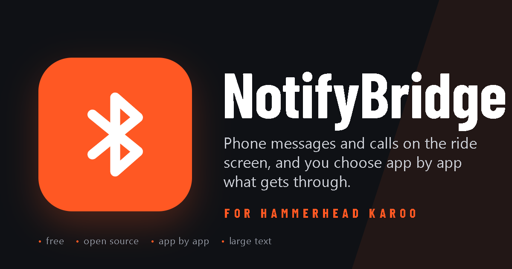

# NotifyBridge

Your phone's messages and calls on the Hammerhead Karoo, in large type at the bottom of the ride screen, and only the ones you choose: app by app, and on WhatsApp person by person and group by group.

Two small apps, one on the phone and one on the Karoo, talking over Bluetooth. No account, no internet, no server in between.

## What you get

**On the ride screen.** Each message arrives as a popup at the bottom of the screen, where it does not cover the numbers at the top: the sender and the text in large bold type, up to four lines, the app's name below. It takes the app's colour (green WhatsApp, blue Telegram, orange for the others), plays two short beeps, and goes away after 10 seconds or with a tap. A call has a ring of its own, three rounds of two alternating tones, unlike any Karoo sound.

**Your choice of text size.** Small, Medium or Large, in the Karoo app. **TEST POPUP** shows a sample message in the size you chose, without waiting for a real one.

**One popup at a time.** If a popup of my other extensions is on screen, the message waits for it, 30 seconds at most.

**Only what you choose**, on the phone:

- apps: each app appears in the list the first time it posts a notification, switched off. WhatsApp, SMS and calls are on from the start;
- WhatsApp: each person and each group appears under it after their first message, switched off. Switch on your family, leave the busy groups off;
- calls: a switch of their own, whatever app rings.

**Not riding**, a message goes to the Karoo's notification centre instead, as the Karoo's own notifications do.

**inReach check** (optional). If you carry a Garmin inReach paired with the phone, the Karoo can warn you 1–2 minutes after the start when the inReach is neither connected to the phone nor seen nearby: off, or with its Bluetooth off. The warning is a full red screen with a siren every 10 seconds, until you tap it (the siren stops by itself after 10 minutes).

## Why it exists

The Karoo already shows the phone's notifications through the Hammerhead companion app, but all of them, with no filter. My work groups kept buzzing on my rides, to be closed one by one in the woods. NotifyBridge lets through only the people I want to hear from while I ride.

## Install

You need both apps: the phone app sends, the Karoo extension shows.

**On the Karoo**

1. Download `NotifyBridge.apk` from the latest release and sideload it, for example from the Hammerhead companion app, or with `adb install -r NotifyBridge.apk`.
2. Open **NotifyBridge** from the Karoo's extensions and tap **Allow popups over the ride screen**. Without it, messages use the Karoo's own alert at the top of the screen.
3. Choose the text size and tap **TEST POPUP** to see it.

Once installed it appears in the Karoo **Extensions** library, and the Karoo checks there for a newer release.

**On the phone** (Android 12 or newer)

1. Download `NotifyBridge-phone.apk` from the same release and open it to install it.
2. Open **NotifyBridge**, tap **Start bridge** and allow **Nearby devices** (Bluetooth) and notifications.
3. Tap **Notification access** and switch NotifyBridge on.

   On Android 13 and newer the switch is greyed out at first, with "Restricted setting": Android does this for every app installed from a file rather than from the Play Store. Tap **App info**, then the **⋮** menu at the top right, then **Allow restricted settings**, and go back to **Notification access**. The app's first line says when access is granted.
4. Tap **Send test**: it should appear on the Karoo.

To avoid every message twice, switch off the phone notifications of the Hammerhead companion app.

## How it works

The phone app reads the notifications Android shows, through the notification access you grant, and keeps only those of the apps, people and groups you switched on. It sends each one as a short Bluetooth Low Energy message to the Karoo: the app's name, the title (the sender, or the group) and the text, shortened to fit one message. Besides the messages it only tells the Karoo, when asked, whether it is still subscribed and whether a Garmin inReach paired with the phone is connected. It never replies to or acts on a notification.

The Karoo extension looks for the phone by the Bluetooth service it advertises, connects, and checks the link every minute; when the phone goes out of range it looks again, at full speed for 2 minutes and then in low-power mode, and reconnects by itself. During a ride the message becomes our popup; otherwise a Karoo notification.

## Privacy

No internet permission in either app, no account, no analytics. Your notifications go from the phone to the Karoo over Bluetooth and nowhere else. The choices you make stay on the phone. Both apps keep a short log of their own in their private storage, for troubleshooting: times, app names, link events, never the text of a message.

## Sibling extensions

- [BetterETA](https://github.com/anpaiss/BetterETA): arrival time that learns how you ride
- [PoiAhead](https://github.com/anpaiss/PoiAhead), [BigFields](https://github.com/anpaiss/BigFields), [AutoLoopKaroo](https://github.com/anpaiss/AutoLoopKaroo), [KarooAxsRatio](https://github.com/anpaiss/KarooAxsRatio), [BoschData](https://github.com/anpaiss/BoschData), [BatteryUsage](https://github.com/anpaiss/BatteryUsage)

All of them on [lagorai.bike/extensions](https://lagorai.bike/extensions/).

## Is it safe?

- The code is all here, open source.
- <!-- TODO first release: VirusTotal link and engines count for both APKs --> Both APKs of each release are checked on VirusTotal; the release notes link the reports.
- <!-- TODO first release: SHA-256 of NotifyBridge.apk and NotifyBridge-phone.apk --> Compare the SHA-256 in the release notes with the files you downloaded (`certutil -hashfile NotifyBridge.apk SHA256` on Windows, `sha256sum NotifyBridge.apk` elsewhere).
- The APKs are built by GitHub Actions from the tagged source, with a signed provenance. Check it with `gh attestation verify NotifyBridge.apk -R anpaiss/NotifyBridge` (and the same for `NotifyBridge-phone.apk`).

## Support

NotifyBridge is free and open source, and will stay that way. If it helped, you can [buy me a coffee on Ko-fi](https://ko-fi.com/anpaiss): it pays for the small things, a development board, a 3D-printed case, a few hours of testing on the trails.

## License

MIT, see [LICENSE](LICENSE).

If you build on this code, or on its ideas, a mention is much appreciated: a link to this repository is enough.
